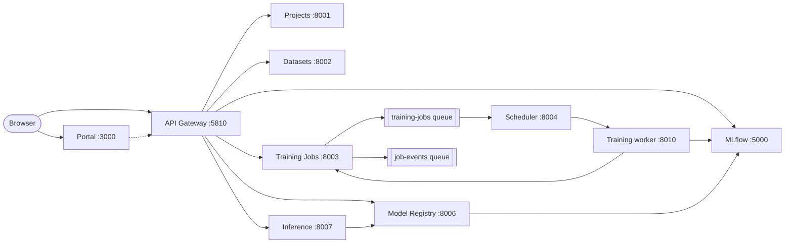

# CloudTrain

A cloud-native ML training platform built as microservices on AWS — a simplified SageMaker / Vertex AI /
Azure ML. Final lab project of **MAAI7102 Software Engineering and Programming** at MBZUAI
(instructors: Manzoor and Asif), built by 13 students as **one** integrated system.

A user logs in, creates a project, uploads and versions a dataset, submits a training job (model,
hyperparameters, CPU/GPU, parallelism), trains on cloud CPU/GPU (single GPU or distributed DDP), tracks
results in MLflow, registers and deploys the best model, sends an image for a prediction, and sees
compute usage and cost — all through one web portal and one gateway.

**New to the team? Start with [`TEAM_GUIDE.md`](TEAM_GUIDE.md).**

## Architecture



Only ports **5810** (gateway) and **3000** (portal) are published. Full design, deployment diagram and
rules: [`docs/ARCHITECTURE.md`](docs/ARCHITECTURE.md). Exact APIs: [`contracts/`](contracts/).

## Services

| Service | Folder | Owner(s) | Port |
|---|---|---|---|
| API Gateway | [`gateway/`](gateway/) | Ali | **5810 (published)** |
| Projects | [`project-service/`](project-service/) | Ali | 8001 |
| Datasets | [`dataset-service/`](dataset-service/) | Faisal | 8002 |
| Training Jobs | [`job-service/`](job-service/) | Mariam | 8003 |
| Scheduler | [`scheduler/`](scheduler/) | Maitha | 8004 |
| Training worker | [`training/`](training/) | Abdullah | 8010 (local dev only) |
| Distributed training (DDP) | [`training/distributed/`](training/distributed/) | Ahmed + Abdulla | — |
| MLflow | [`mlflow/`](mlflow/) | Abdullah | 5000 |
| Model Registry | [`model-registry/`](model-registry/) | Majed | 8006 |
| Inference | [`inference-service/`](inference-service/) | Majed | 8007 |
| Web Portal | [`portal/`](portal/) | Hilal + Adel | **3000 (published)** |
| Terraform infrastructure | [`infrastructure/`](infrastructure/) | Hamda + Fatma | — |
| CI/CD, login, security | [`.github/workflows/`](.github/workflows/), [`security/`](security/) | Salem | — |

## Quick start

You need Docker Desktop, git, Python 3.11, Node 24 and make.

```bash
cp .env.example .env   # local settings (fake values, never commit .env)
make up                # start everything
make test              # unit tests
make check             # lint + unit + contract + end-to-end tests — run before every pull request
```

Then open the portal at http://localhost:3000 and the gateway at http://localhost:5810/health.

## How we work
Issue → branch `<name>/<short-task>` → small commits → `make check` → pull request with `Closes #N` →
CI + a teammate's review (Ali for shared files) → merge. Details in
[`docs/TEAM_WORKFLOW.md`](docs/TEAM_WORKFLOW.md) and [`TEAM_GUIDE.md`](TEAM_GUIDE.md).

## Documents
[Architecture](docs/ARCHITECTURE.md) · [APIs](docs/api/) · [Database](docs/database/) ·
[Deployment](docs/DEPLOYMENT_GUIDE.md) · [Testing](docs/TESTING.md) · [Benchmarks](docs/BENCHMARKS.md) ·
[Evaluation](docs/EVALUATION.md) · [Decisions](docs/decisions/) · [Open decisions](docs/OPEN_DECISIONS.md) ·
[Final report](docs/FINAL_REPORT.md)

**Deadline:** ready and submitted Fri 27 Nov 2026 (the system closes at 12:00 AM on 30 Nov).
