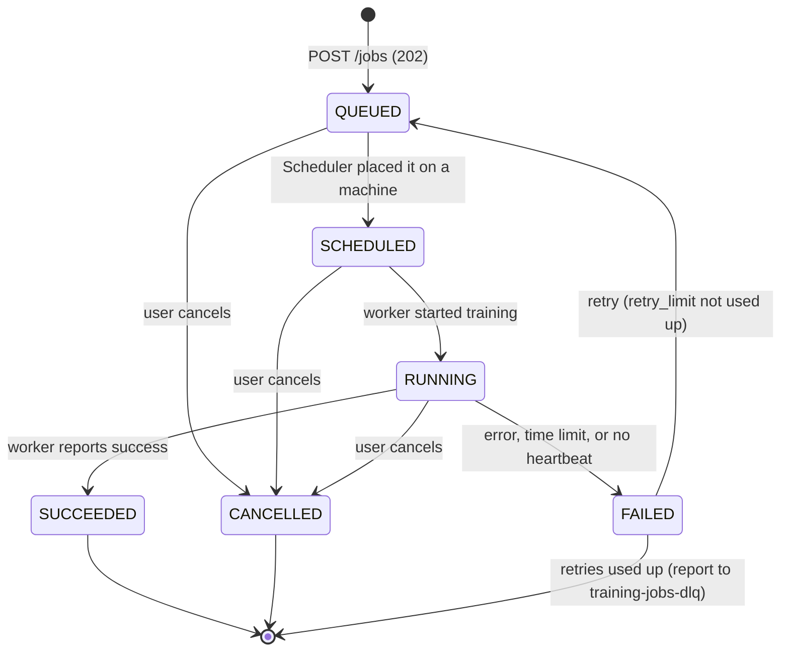

# Job status steps

Owner of the state machine: **Mariam** (Training Jobs). Reporters: **Maitha** (Scheduler) and **Abdullah** (worker).
Changing this file is a contract change (see `contracts/README.md`).

## The steps

| From | To | Who causes it | Event |
|---|---|---|---|
| (new) | `QUEUED` | Training Jobs, on `POST /jobs` | `job.queued` |
| `QUEUED` | `SCHEDULED` | Scheduler: `POST /internal/jobs/{id}/status` with the machine type | `job.scheduled` |
| `SCHEDULED` | `RUNNING` | Scheduler (or worker) reports it started, with `started_at` | `job.running` |
| `RUNNING` | `SUCCEEDED` | Worker reports success, with `finished_at` | `job.succeeded` |
| `RUNNING` | `FAILED` | Worker reports an error or crash | `job.failed` |
| `RUNNING` | `FAILED` | Training Jobs: `max_runtime_minutes` has passed | `job.failed` |
| `RUNNING` | `FAILED` | Training Jobs: no heartbeat for `HEARTBEAT_TIMEOUT_SECONDS` (the worker died) | `job.failed` |
| `FAILED` | `QUEUED` | Training Jobs, while `retry_limit` is not used up; the job goes back on `training-jobs` | `job.retrying` |
| `FAILED` | (stays) | Retries used up; a failure report goes to `training-jobs-dlq` | — |
| `QUEUED` / `SCHEDULED` / `RUNNING` | `CANCELLED` | The user: `POST /jobs/{id}/cancel` | `job.cancelled` |

## Rules

1. **A job can never stay `RUNNING` forever.** The heartbeat check and the time limit always end it.
2. Every change is stored in the job's `history` and published to the `job-events` queue
   (shape: `contracts/events/job-event.schema.json`).
3. A report that is not allowed from the current status gets **409**. That is how the Scheduler and the
   worker learn a job was cancelled: they stop the work and the Scheduler releases the machine.
   The heartbeat answer also carries the current status, so a running worker sees `CANCELLED` within
   one heartbeat interval.
4. `SUCCEEDED`, `CANCELLED` and `FAILED` (with retries used up) are final.

## Heartbeat settings (settings, not contract rules)

| Setting | Default | Meaning |
|---|---|---|
| `HEARTBEAT_INTERVAL_SECONDS` | 30 | How often the worker says "I am still alive" |
| `HEARTBEAT_TIMEOUT_SECONDS` | 120 | Silence after which the job is FAILED |

Both live in `.env.example`. Mariam and Maitha may tune them without a contract change,
as long as the timeout stays **at least 3 times** the interval.
