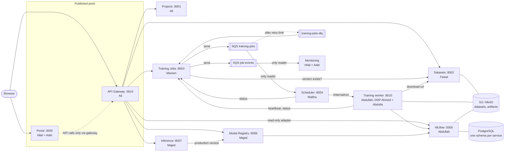
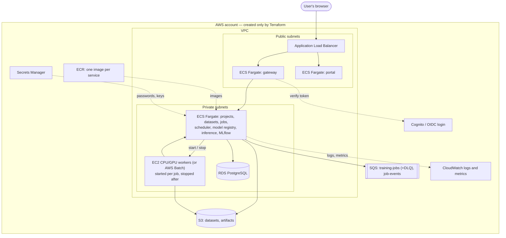

# CloudTrain architecture

**Owner:** Ali (Student 1). This is the single source of truth; changes need Ali's approval (CODEOWNERS).
Exact request and response shapes are in `contracts/`.

CloudTrain is one cloud-native ML training platform built as microservices on AWS, a simplified
SageMaker / Vertex AI / Azure ML. A user logs in, creates a project, uploads and versions a dataset,
configures and submits a training job (model, hyperparameters, CPU/GPU, parallelism), trains on cloud
CPU/GPU (single GPU or distributed), tracks results in MLflow, compares single-GPU and distributed runs,
registers and deploys the best model behind a REST API, sends an image for a prediction, and sees
compute usage and estimated cost. All through one web portal and one gateway.

**The key question:** *How do we turn an ML training script into a scalable, automated, reliable and
reusable cloud ML service?* A pile of separate Python scripts cannot be shared safely, cannot run for
hours without someone watching, cannot recover when a machine dies, cannot scale its parts separately,
and leaves no record of what was trained on what. Microservices, cloud infrastructure, distributed
computing and DevOps each fix part of that.

## 1. Architecture diagram



Every service also has its own schema in PostgreSQL (lines omitted for clarity).

## 2. Deployment diagram (which AWS piece runs what)



## 3. Main principles
1. **Microservices.** Each service owns one capability, has its own folder, database schema and Docker
   image, and can be deployed alone. Different workloads scale separately: upload is storage work,
   training is heavy and long, inference must be fast.
2. **One front door.** All API traffic enters through the gateway on port 5810. The portal (port 3000) is
   the only other published port and only serves web pages. The portal calls only the gateway.
   Services never read another service's database; they call its API.
3. **Asynchronous long work.** `POST /jobs` returns **202 Accepted** with a job ID immediately and the job
   goes into a queue. Nobody keeps a request open while training runs.
4. **Events, not polling.** Status changes are published as events. No service checks another on a tight
   timer; where a client must poll, it waits at least 5 seconds and backs off.
5. **Idempotent.** A queue message can arrive twice; handling it twice must not do the work twice.
   Create requests accept an `Idempotency-Key`.
6. **Persistent state.** Datasets, models, experiment metadata and job records survive container restarts.
7. **Cloud-native, infrastructure as code.** Services and training run in AWS. Terraform creates all cloud
   resources, with remote state, locking and restricted access. Nothing is created by hand.
8. **Observable.** Every service writes JSON logs with `request_id` and exposes `/health` and `/metrics`
   (Prometheus format).
9. **Automated.** Every change goes through a pull request, CI checks and a review before it reaches `main`.

## 4. Services, owners, ports

| Service | Folder | Owner(s) | Port | Reached by |
|---|---|---|---|---|
| API Gateway | `gateway/` | Ali | **5810 (published)** | browser / portal |
| Projects (identity and projects) | `project-service/` | Ali | 8001 | gateway |
| Datasets | `dataset-service/` | Faisal | 8002 | gateway, job service, workers |
| Training Jobs | `job-service/` | Mariam | 8003 | gateway, scheduler, workers |
| Scheduler | `scheduler/` | Maitha | 8004 | internal only |
| Training runtime / worker | `training/` | Abdullah | 8010 (internal, local dev only) | scheduler |
| Distributed training (DDP) | `training/distributed/` | Ahmed + Abdulla | — (part of the worker) | — |
| MLflow tracking + model registry backend | `mlflow/` (config only, official image) | Abdullah | 5000 | gateway (read only), workers, model registry |
| Model Registry and deployment | `model-registry/` | Majed | 8006 | gateway, inference |
| Inference | `inference-service/` | Majed | 8007 | gateway |
| Web Portal (UI, job alerts, monitoring and cost pages) | `portal/` | Hilal + Adel | **3000 (published)** | browser |
| Terraform cloud infrastructure | `infrastructure/` | Hamda + Fatma | — | — |
| CI/CD, login, secrets, security | `.github/workflows/`, `security/` | Salem | — | — |

**The brief's 8 logical services:**

| Brief's service | Covered by |
|---|---|
| Identity & Project | Projects + login at the gateway |
| Dataset | Datasets |
| Training Job | Training Jobs |
| Training Scheduler | Scheduler |
| Experiment Tracking | MLflow, behind a gateway adapter route |
| Model Registry | Model Registry |
| Inference | Inference |
| Notification | Job events, consumed by the portal's alert feed and the monitoring stack (no separate container) — see `decisions/0002` |

## 5. Gateway routes (`gateway/app/routes.yaml`)

| Public path | Forwards to | Methods |
|---|---|---|
| `/api/v1/users/me`, `/api/v1/projects/*` | `http://project-service:8001` (strip `/api/v1`) | all |
| `/api/v1/datasets/*` | `http://dataset-service:8002` (strip `/api/v1`) | all |
| `/api/v1/jobs/*` | `http://job-service:8003` (strip `/api/v1`) | all |
| `/api/v1/experiments/*` | `http://mlflow:5000/api/2.0/mlflow/*` (**rewrite**) | GET, plus POST on paths ending in `/search` only |
| `/api/v1/models/*` | `http://model-registry:8006` (strip `/api/v1`) | all |
| `/api/v1/predict/*` | `http://inference-service:8007` (strip `/api/v1`) | all |
| `/health`, `/metrics` | the gateway itself | GET |

On every request the gateway verifies the login token (JWT), adds `X-User-Id` and `X-Request-Id`
(creating a request ID if none came in), and forwards with a 10-second timeout (uploads: 300 seconds).
A downstream service that is down or times out gives **503** in the shared error format. Any path
containing `/internal/` gives **404**. CORS allows `http://localhost:3000` and the deployed portal URL.

## 6. Public API per service (owners may add endpoints, never break these)
- **Projects (8001):** `POST /projects`, `GET /projects`, `GET /projects/{id}`, `POST /projects/{id}/members`, `GET /users/me`
- **Datasets (8002):** `POST /datasets` (multipart, validates format, stores checksum), `GET /datasets?project_id=`,
  `GET /datasets/{id}`, `POST /datasets/{id}/versions`, `GET /datasets/{id}/versions/{v}`, `GET /datasets/{id}/versions/{v}/download`
- **Training Jobs (8003):** `POST /jobs` → 202, `GET /jobs?project_id=`, `GET /jobs/{id}` (status, history,
  `machine_type`, `gpu_hours`, `estimated_cost_usd`), `POST /jobs/{id}/cancel`, `GET /jobs/{id}/events`,
  `GET /jobs/events?after=<event_id>&project_id=` (the alert feed, newest last; the portal calls it every 5–10 s with back-off)
- **Model Registry (8006):** `POST /models` (from an MLflow run ID, linked to job and dataset version), `GET /models`,
  `GET /models/{id}/versions`, `GET /models/{id}/production`, `POST /models/{id}/versions/{v}/promote`, `POST /models/{id}/rollback`
- **Inference (8007):** `POST /predict`, `GET /model-info`, `GET /health`

## 7. Internal calls (service to service, never through the gateway)

| Caller | Calls | Why |
|---|---|---|
| Training Jobs | `GET dataset-service:8002/datasets/{id}/versions/{v}` | Confirm the dataset version exists before accepting a job |
| Training worker | `GET dataset-service:8002/internal/datasets/{id}/versions/{v}/download-url` | Time-limited S3 link to download the data |
| Scheduler | `POST job-service:8003/internal/jobs/{id}/status` | Report Scheduled / Running / Failed / Succeeded, machine type, start and end times |
| Scheduler | `POST training-worker:8010/internal/run` (local); starts an EC2 instance with the job form (cloud) | Hand one job to one worker |
| Training worker | `POST job-service:8003/internal/jobs/{id}/heartbeat` | "I am still alive", every `HEARTBEAT_INTERVAL_SECONDS` (default 30) |
| Training worker | `POST job-service:8003/internal/jobs/{id}/status` | Report Succeeded or Failed when training ends |
| Training worker | MLflow API on `mlflow:5000` | Log parameters and metrics, save the model |
| Model Registry | MLflow API on `mlflow:5000` | Read the run's metrics, register the model version |
| Inference | `GET model-registry:8006/models/{id}/production` | Know which model version to load |
| Any service | `GET project-service:8001/projects/{id}` with the user's `X-User-Id` | Membership check (200 / 403 / 404) |

## 8. Who reads the queue (one reader per queue)

| Queue | Written by | Read by |
|---|---|---|
| `training-jobs` | Training Jobs (Mariam) | **Scheduler only** (Maitha). Workers never read this queue. |
| `training-jobs-dlq` | SQS (after the retry limit) | Training Jobs, for failure reports |
| `job-events` | Training Jobs, whenever a status changes | Monitoring (Hilal + Adel), for dashboards. Training Jobs also stores every event in its database to serve the alert feed. |

Queue settings: encryption on; dead-letter redrive on `training-jobs`; the visibility timeout covers
scheduling time; the scheduler deletes the message once a worker has accepted the job — after that the
job is protected by the heartbeat lease, not by the queue.

## 9. Shared rules (every service)
1. FastAPI, with OpenAPI at `/openapi.json` matching its file in `contracts/`.
2. **Error format** for every non-2xx response:
   `{"error": {"code": "DATASET_NOT_FOUND", "message": "Dataset dataset-07 does not exist", "request_id": "req-8f2a"}}`.
   Codes are `UPPER_SNAKE_CASE`.
3. **Status codes:** 200 read · 201 created · 202 accepted for long work · 400 bad input · 401 not logged in ·
   403 not allowed · 404 not found · 409 conflict / duplicate · 422 validation · 429 slow down · 503 dependency down.
4. **Login:** the gateway verifies the JWT. Local dev mode (`AUTH_MODE=dev`) accepts a fixed test token from
   `.env`. Salem's real login is added behind the same function. Services trust only gateway headers and
   check project membership through the Projects service.
5. **Idempotency:** `Idempotency-Key` on create requests — the same key returns the first result.
   Queue consumers store the `event_id`s they have already handled.
6. **Health and metrics:** `GET /health` returns 200 when ready; `GET /metrics` is Prometheus format.
7. **Logs:** one JSON line per request with `timestamp`, `service`, `level`, `request_id`, `path`, `status`, `duration_ms`.
8. **Naming:** plural nouns in paths, `snake_case` JSON, IDs `<kind>-<n>` (`job-104`), ISO 8601 UTC dates,
   every public path starts with `/api/v1/`.
9. **Configuration:** only environment variables, nothing hard-coded, every variable listed in `.env.example`.

## 10. The training job form (`contracts/training-job.schema.json`)
```json
{
  "job_id": "job-104",
  "project_id": "project-01",
  "dataset_id": "dataset-07",
  "dataset_version": 2,
  "model": "resnet18",
  "hyperparameters": {"epochs": 10, "batch_size": 32, "learning_rate": 0.001},
  "resources": {"gpu_count": 2, "cpu_cores": 8, "memory_gb": 32},
  "parallelism": {"strategy": "ddp", "world_size": 2},
  "execution": {"max_runtime_minutes": 120, "retry_limit": 2}
}
```
- `parallelism.strategy`: `single` or `ddp`. Later `hparam_search` (recommended) and `tensor` / `pipeline`
  (advanced; only on real multi-GPU hardware).
- `world_size` equals `gpu_count` for `ddp`.
- `dataset_version` is our addition to the brief, so a job always trains on a fixed version.
- Validated by Training Jobs, read by the Scheduler, run by the worker. `POST /jobs` takes it without `job_id`.
- Changing it needs agreement from Mariam, Maitha, Abdullah, Ahmed/Abdulla and Ali.

## 11. Job status steps (`contracts/job-states.md`)
- `QUEUED → SCHEDULED → RUNNING → SUCCEEDED`
- `QUEUED / SCHEDULED / RUNNING → CANCELLED` (the user cancels; the scheduler stops the worker and releases the machine)
- `RUNNING → FAILED` when the training errors or crashes, `max_runtime_minutes` passes, or there is no
  heartbeat for `HEARTBEAT_TIMEOUT_SECONDS` (default 120). Both heartbeat numbers are settings, not contract
  rules; the timeout must stay at least 3 times the interval.
- `FAILED → QUEUED` while `retry_limit` is not used up (event `job.retrying`); after that it stays `FAILED`
  and a report goes to `training-jobs-dlq`.
- Every change is stored in the job's history and published to `job-events`. **A job can never stay RUNNING forever.**
- How a cancel reaches running work: a status report or heartbeat for a cancelled job is answered with 409 /
  `status: CANCELLED`, and the reporter stops.

## 12. Events (`contracts/events/job-event.schema.json`)
Every event has `event_id`, `event_type`, `job_id`, `project_id`, `occurred_at` and `data`.
Types: `job.queued`, `job.scheduled`, `job.running`, `job.succeeded`, `job.failed`, `job.cancelled`, `job.retrying`.

## 13. Cost
`contracts/pricing.yaml` lists the hourly price per machine type (Hamda + Fatma, from AWS prices). The
Scheduler reports the machine type and start/end times. Training Jobs computes `gpu_hours` and
`estimated_cost_usd`. The portal shows them per job and per project (Hilal + Adel).

## 14. Data stores

| Store | Local stand-in | Cloud | Owner |
|---|---|---|---|
| PostgreSQL schema `projects` | postgres container | RDS PostgreSQL | Ali |
| schema `datasets` (records, versions, checksums, lineage, audit) | same | same | Faisal |
| schema `jobs` (jobs, history, events, retries, cost) | same | same | Mariam |
| schema `scheduler` (workers, capacity, quotas) | same | same | Maitha |
| schema `mlflow` (MLflow runs and model registry) | same | same | Abdullah |
| schema `registry` (deployments, live version, rollback history) | same | same | Majed |
| Bucket `datasets` (one folder per dataset version) | MinIO | S3 | Faisal |
| Bucket `artifacts` (checkpoints, models) | MinIO | S3 | Abdullah, Majed |
| Queues `training-jobs`, `training-jobs-dlq`, `job-events` | LocalStack SQS | SQS | see section 8 |

## 15. Cloud mapping

| Part | AWS |
|---|---|
| Services, gateway, portal | ECS Fargate (stateless services) |
| Images | ECR |
| Training workers | EC2 CPU / **GPU** instances or AWS Batch, started per job (**GPU training never runs on Fargate**) |
| Database | RDS PostgreSQL |
| Files | S3 |
| Queues | SQS |
| Login | Cognito or external OIDC |
| Secrets | Secrets Manager |
| Logs and metrics | CloudWatch (+ Prometheus/Grafana) |
| Network | VPC: gateway and portal behind a load balancer in public subnets, everything else in private subnets |

Every resource is tagged `Project`, `Environment`, `Owner`. Terraform state lives in an S3 backend with
locking and restricted access; state and secrets are never committed. GPU machines run only while a job
runs. `terraform destroy` on disposable environments after each test session. Encryption and
least-privilege IAM everywhere. Folder layout and the 7 mandatory Terraform demos: `infrastructure/README.md`.

## 16. Training and parallelism

| Technique | Level | Example |
|---|---|---|
| Single-worker training | **Mandatory** | ResNet-18 on 1 GPU |
| Data parallelism | **Mandatory** | PyTorch DistributedDataParallel |
| CPU data-loading parallelism | **Mandatory** | Several DataLoader workers |
| Hyperparameter search parallelism | Recommended | Several independent trials |
| Model / tensor parallelism | Advanced | Split a model across GPUs |
| Pipeline parallelism | Advanced | Split layers across devices |

- The minimum is a real comparison of 1 GPU vs multi-GPU DDP: speedup, efficiency, throughput, GPU-hours and cost.
- Tensor and pipeline parallelism only run on real hardware; never simulated and presented as real GPU scaling.
- The parallelism selector: single worker when the model fits on one GPU and the data is small; DDP when
  throughput is the limit and several GPUs are available; model parallelism when the model does not fit on
  one GPU; parallel trials for independent experiments. It weighs GPU availability, memory, model size,
  dataset size, communication overhead and budget.
- Two use cases: image classification (CIFAR-10 + ResNet-18) and one tabular classification dataset (open decision).

## 17. Minimum vs advanced (build the minimum first)

| Area | Minimum | Advanced |
|---|---|---|
| Microservices | 6+ integrated services | Service mesh, distributed tracing |
| Cloud | Real deployment with Terraform | Multi-environment, multi-region |
| Training | Single-worker and DDP | Tensor / pipeline parallelism |
| Scheduling | Queue and resource allocation | Priority / fair-share |
| Data | Object storage and versioning | Lineage and validation pipelines |
| MLOps | MLflow and model registry | Automated retraining |
| Deployment | Containerised inference API | Canary or blue-green |
| CI/CD | Automated build, test, deploy | GitOps and policy gates |
| Monitoring | Metrics, logs, dashboard | SLO alerting, anomaly detection |
| Cost | GPU-hour reporting | Budget-aware scheduling |

## 18. End-to-end walk-through (final demo and main integration test)

| # | Step | Owner |
|---|---|---|
| 1 | Log in | Salem |
| 2 | Create project "Image Classification": `POST /api/v1/projects` → 201 `project-01` | Ali |
| 3 | Upload CIFAR-10: `POST /api/v1/datasets` → 201 `dataset-07` v1 | Faisal |
| 4 | Submit job (ResNet-18, settings, resources, strategy): `POST /api/v1/jobs` → 202 `job-104` | Mariam |
| 5 | Queued, then Scheduled on the right machine, then Running | Maitha |
| 6 | Training with live metrics in MLflow and the model saved to S3 | Abdullah; Ahmed + Abdulla |
| 7 | Job Succeeded, alert shown in the portal, machine released | Mariam, Maitha, Hilal + Adel |
| 8 | Compare a single-GPU run with a DDP run | Hilal + Adel; Ahmed + Abdulla |
| 9 | Register the best model: `POST /api/v1/models` → 201 v1 | Majed |
| 10 | Promote v1; inference passes `/health` before taking traffic | Majed |
| 11 | Send an image: `POST /api/v1/predict` → 200 prediction | Majed |
| 12 | View compute usage, GPU-hours and estimated cost | Hilal + Adel |

The final demo also shows the Terraform-provisioned infrastructure, the CI/CD pipeline, and **one
failure-recovery scenario**: a worker is killed mid-job, the heartbeat stops, the job is retried and finishes.

## 19. Dependencies

| Student | Depends on | Integrates with |
|---|---|---|
| 1 Ali | 9 (identity) | all |
| 2 Faisal | 6 (storage) | 1, 3, 4 |
| 3 Mariam | 6 (queue, database) | 1, 4, 7, 10 |
| 4 Abdullah | 2 (datasets) | 3, 5, 7, 8 |
| 5 Ahmed + Abdulla | 4 (training runtime) | 6, 7, 10 |
| 6 Hamda + Fatma | cloud account and quotas | all |
| 7 Maitha | 6 (compute) | 3, 4, 5 |
| 8 Majed | 4 (artifacts) | 1, 9, 10 |
| 9 Salem | 1 (API contracts) | all |
| 10 Hilal + Adel | APIs and metrics from everyone | all |

Students 3, 4, 5 and 7 share the training job form.

Roles in detail, the dated schedule and the hand-offs are in `TEAM_GUIDE.md`. Decisions are in `docs/decisions/`.
