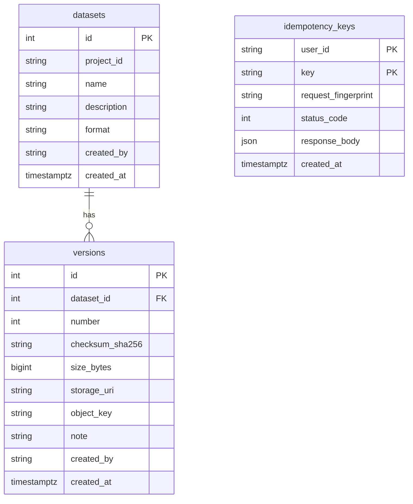

# Schema `datasets` — the Datasets service

**Owner:** Faisal (Student 2). Only the Datasets service reads or writes this schema; other services call its API.
**Holds:** dataset records, versions, checksums (lineage and audit come later).

The schema and its database user `datasets` are created by the database setup (locally the postgres
start-up script, in the cloud the infrastructure setup). The service's user owns the schema but cannot
create new schemas (least privilege).

## Tables

| Table | What one row is | Key columns |
|---|---|---|
| `datasets` | One dataset | `id` (shown outside as `dataset-01`), `project_id`, `name`, `description`, `format`, `created_by`, `created_at` |
| `versions` | One version of one dataset | `id`; (`dataset_id`, `number`) unique; `checksum_sha256`, `size_bytes`, `storage_uri`, `object_key`, `note`, `created_by`, `created_at` |
| `idempotency_keys` | The first answer to a create request sent with an `Idempotency-Key` | (`user_id`, `key`) unique; `request_fingerprint`, `status_code`, `response_body`, `created_at` |
| `alembic_version` | Which migration has been applied (kept by Alembic) | `version_num` |

## Relationships


## Indexes and constraints
- `ix_datasets_project_id`: fast list by project (`GET /datasets?project_id=`).
- `uq_versions_dataset_number`: a dataset cannot have two rows with the same version number.
- `idempotency_keys` primary key (`user_id`, `key`): two identical create requests can never both be saved.
- All times are stored in UTC (`timestamptz`).

## Object storage
Files live in the `datasets` bucket. Version *n* of `dataset-07` is stored as key
`dataset-07/vN/data` and reported as `storage_uri = s3://datasets/dataset-07/vN/`.

## Migrations
Migrations are in `dataset-service/migrations/versions/`. The container applies them on start
(`alembic upgrade head`) before serving requests. To add one:
```bash
cd dataset-service
DATABASE_URL=postgresql+psycopg://... .venv/bin/alembic revision -m "what changes"
```
