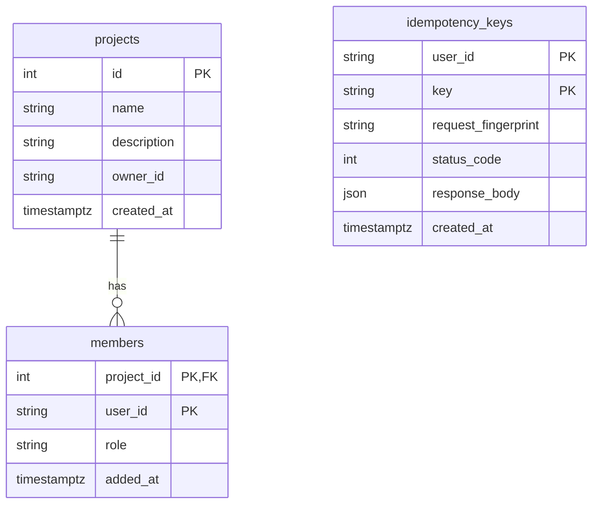

# Schema `projects` — Projects service

**Owner:** Ali (Student 1). Only the Projects service reads or writes this schema; other services call
its API (`GET /projects/{project_id}` is the membership check).
**Holds:** projects, members, idempotency keys.

The schema and its database user `projects` are created by the database setup (locally the postgres
start-up script, in the cloud the infrastructure setup). The service's user owns the schema but cannot
create new schemas (least privilege).

## Tables

| Table | What one row is | Key columns |
|---|---|---|
| `projects` | One project | `id` (number; shown outside as `project-01`), `name`, `description`, `owner_id`, `created_at` |
| `members` | One user in one project | (`project_id`, `user_id`) together are unique; `role` = `owner` or `member`; `added_at` |
| `idempotency_keys` | The first answer to a create request sent with an `Idempotency-Key` | (`user_id`, `key`) together are unique; `request_fingerprint`, `status_code`, `response_body`, `created_at` |
| `alembic_version` | Which migration has been applied (kept by Alembic) | `version_num` |

## Relationships


## Indexes and constraints
- `members` primary key (`project_id`, `user_id`): a user can be in a project only once (409 if added twice).
- `ix_members_user_id`: fast answer to "which projects is this user in?" (`GET /projects`, `GET /users/me`).
- `idempotency_keys` primary key (`user_id`, `key`): two identical create requests can never both be saved.
- All times are stored in UTC (`timestamptz`).

## Migrations
Migrations are in `project-service/migrations/versions/`. The container applies them on start
(`alembic upgrade head`) before serving requests. To add one:
```bash
cd project-service
DATABASE_URL=postgresql+psycopg://... .venv/bin/alembic revision -m "what changes"
```
