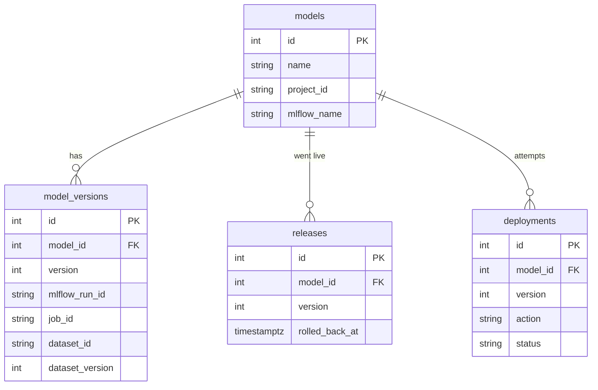

# Schema `registry` — the Model Registry

**Owner:** Majed (Student 8). Only the Model Registry reads or writes this schema; other services call its API.
**Holds:** models and their versions (linked to MLflow run, job and dataset version), which version is
live, rollback history, and every deployment attempt.

MLflow keeps the runs and its own model registry in the schema `mlflow`; this schema keeps what is
CloudTrain's. The schema and its database user `registry` are created by the database setup (locally
the postgres start-up script, in the cloud the infrastructure setup); the service's user cannot
create schemas.

## Tables

| Table | What one row is | Key columns |
|---|---|---|
| `models` | One model (a name inside a project) | `id` (shown outside as `model-01`), `name`, `project_id`, `mlflow_name` (registered model in MLflow), `created_by`, `created_at` |
| `model_versions` | One registered version | `model_id`, `version`, `mlflow_run_id`, `mlflow_version`, `mlflow_model_id` (MLflow 3 logged model), `job_id`, `dataset_id`, `dataset_version`, `metrics` (JSON), `artifact_uri` (S3 place of the model files), `registered_by`, `created_at` |
| `releases` | One time a version went live | `model_id`, `version`, `promoted_by`, `promoted_at`, `rolled_back_at` (set by rollback) |
| `deployments` | One promote or rollback attempt | `model_id`, `version`, `action` (`promote` / `rollback`), `status` (`succeeded` / `failed`), `detail` (e.g. why the health check failed), `requested_by`, `created_at` |
| `idempotency_keys` | The first answer to `POST /models` sent with an `Idempotency-Key` | (`user_id`, `key`), `request_fingerprint`, `status_code`, `response_body`, `created_at` |
| `alembic_version` | Which migration has been applied (kept by Alembic) | `version_num` |

**Which version is live:** the newest `releases` row of the model whose `rolled_back_at` is empty.
Rollback marks that row rolled back, so the one before it is live again. A version that was live once
and is not now is shown with stage `archived`.

## Relationships

## Indexes and constraints
- `models (project_id, name)` unique: one model per name in a project.
- `model_versions (model_id, version)` unique; `(model_id, mlflow_run_id)` unique: a run is registered
  once per model (a second try gets 409).
- `idempotency_keys (user_id, key)` primary key: a repeated request returns the first answer.
- Indexes on `releases.model_id` and `deployments.model_id`.
- Promote and rollback lock the model's row (`SELECT … FOR UPDATE`), so two at once cannot both win.

## Migrations
Alembic, in `model-registry/migrations/`. The container runs `alembic upgrade head` before it starts.
New migration: add a file in `migrations/versions/` (next number, `down_revision` = the previous one).
